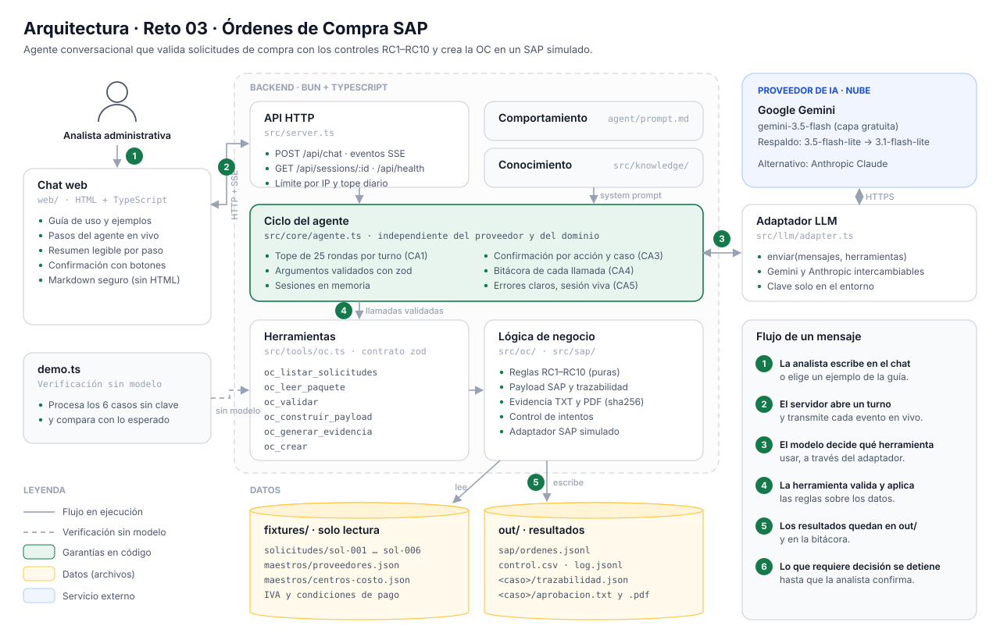

# Reto 03 — Agente conversacional "Órdenes de Compra SAP"

Agente que lee el paquete de cada solicitud de compra (solicitud, cotización, aprobación del líder y, si llega, factura), lo valida contra los maestros con los controles RC1–RC10, arma la orden de compra (OC) tal como quedaría en SAP, genera la evidencia de aprobación y la crea en un SAP simulado. Las excepciones se devuelven a la analista con una recomendación y solo avanzan con su confirmación explícita.

- **Link de prueba:** _pendiente de despliegue_
- **Planteamiento de la solución:** [`SOLUCION.md`](SOLUCION.md)
- **PRD del reto:** [`docs/PRD.md`](docs/PRD.md)

La interfaz se explica sola: la pantalla inicial muestra cómo funciona, ejemplos con lo que se puede esperar y los datos de prueba disponibles, y el botón **Guía de uso** abre un manual con las confirmaciones, la lectura de la pantalla, los resultados y los límites. El contenido de la guía está en `src/presentacion.ts`.



## Puesta en marcha (un comando)

```bash
bun install
cp .env.example .env     # pega tu clave gratuita de https://aistudio.google.com/apikey en LLM_API_KEY
bun run dev              # front + backend en http://localhost:3000
```

Con Docker: `docker build -t reto-03 . && docker run -p 3000:3000 --env-file .env reto-03`.

## Verificación sin modelo de lenguaje

```bash
bun install && bun run demo.ts
```

Procesa los 6 casos llamando directamente a las herramientas, sin ninguna clave. Por caso imprime `apta`, bloqueos, confirmaciones, `retroactiva` y número de OC o motivo. Muestra la idempotencia (sol-001 dos veces) y una confirmación explícita (sol-004). Compara cada caso con el resultado esperado y sale con código 1 si algo no coincide. `out/` se limpia al inicio, así que dos ejecuciones dan el mismo resultado.

| Caso | Resultado |
|---|---|
| sol-001 | ✅ OC 4500000001 creada sin intervención |
| sol-002 | ⛔ RC1: el proveedor (NIT 901999000) no existe |
| sol-003 | ⛔ RC2: quien aprueba no es aprobador de CC-2020 |
| sol-004 | ⚠️ RC5: la cotización difiere 6 % → se crea tras confirmar |
| sol-005 | ⚠️ RC8: retroactiva (factura anterior a la solicitud) |
| sol-006 | ⚠️ RC6: IVA derivado del proveedor (C1); RC7 deriva Z030 |

Otros comandos: `bun test` (sin clave), `bun run typecheck`, `bun run modulo` (regenera `modulo/`).

## Variables de entorno

| Variable | Uso | Por defecto |
|---|---|---|
| `LLM_PROVIDER` | Proveedor de lenguaje: `gemini` o `anthropic` | `gemini` |
| `LLM_MODEL` | Modelo; vacío = el del proveedor | `gemini-3.5-flash` (respaldo automático a `gemini-3.5-flash-lite` y `gemini-3.1-flash-lite`) |
| `LLM_API_KEY` | Clave del proveedor. Solo en el entorno del backend: nunca en el repo, el front, los logs ni la API | — |
| `LLM_TIMEOUT_MS` | Tiempo máximo de espera al proveedor | `120000` |
| `MAX_ITERACIONES` | Rondas herramienta → modelo por turno | `25` |
| `MAX_TOKENS_SESION` | Tope de tokens por conversación | `500000` |
| `MAX_TOKENS_DIA` | Tope diario de tokens para todo el servidor (el link es público) | `3000000` |
| `MAX_MENSAJES_POR_IP` / `VENTANA_MINUTOS` | Mensajes permitidos por IP en cada ventana | `30` cada `10` minutos |
| `FECHA_REFERENCIA` | Fecha de referencia del negocio. `2026-09-03` reproduce el escenario de la prueba | hoy |
| `PORT` | Puerto HTTP | `3000` |

## API

| Método | Ruta | Descripción |
|---|---|---|
| `POST` | `/api/chat` | `{ sessionId, message }` → stream SSE de eventos: `texto`, `llamada` (nombre y argumentos), `resultado` (ok, resumen, si pide confirmación), `error`, `fin_turno` (`necesitaConfirmacion`, uso de tokens) |
| `GET` | `/api/sessions/:id` | Historial completo de la sesión |
| `DELETE` | `/api/sessions/:id` | Descarta la sesión |
| `GET` | `/api/health` | `{ ok, provider, model }`, sin exponer claves |
| `GET` | `/api/herramientas` | Herramientas registradas |
| `GET` | `/api/info` | Título, descripción y sugerencias que muestra el chat |

La referencia de la sección 6.4 del PRD (`{ reply, toolCalls[], needsConfirmation }`) se entrega como stream: el texto llega en eventos `texto`, cada llamada en `llamada` y `resultado`, y `fin_turno` trae `necesitaConfirmacion`. `POST /api/chat` responde 429 si una IP supera su límite de mensajes.

## Herramientas

| Herramienta | Qué hace |
|---|---|
| `oc_listar_solicitudes` | Lista los casos disponibles |
| `oc_leer_paquete` | Lee y normaliza correo, solicitud, cotización, aprobación y factura; los adjuntos ausentes quedan en `null` y en `faltantes` |
| `oc_validar` | Aplica RC1–RC10: `apta`, bloqueos, confirmaciones, derivados, `retroactiva` y el estado de cada regla |
| `oc_construir_payload` | Arma la OC (sección 7.4) y guarda `out/<caso>/trazabilidad.json` |
| `oc_generar_evidencia` | Escribe `out/<caso>/aprobacion.txt` y `.pdf` con su sha256 |
| `oc_crear` | Crea la OC en el SAP simulado (`out/sap/ordenes.jsonl`), de forma idempotente, y registra cada intento en `out/control.csv` |

## Estructura

```
agent/prompt.md              comportamiento (system prompt)
src/knowledge/               conocimiento del proceso (RC1–RC10, retroactivas, datos SAP)
src/tools/oc.ts              herramientas: { description, args (zod), execute } → oc_<export>
src/oc/                      lógica de negocio: fuentes, reglas, payload, evidencia, control
src/sap/adapter.ts, mock.ts  interfaz SapAdapter y SAP simulado sobre archivos
src/core/                    ciclo del agente, confirmación, sesiones, bitácora (genérico)
src/llm/                     adaptador LLM neutral + Gemini y Anthropic
src/server.ts                API HTTP + SSE
web/                         chat (HTML + TypeScript, sin framework)
modulo/                      bonus: agente empaquetado (generado desde las mismas fuentes)
fixtures/reto-03/            datos entregados (solo lectura)
out/                         generado en ejecución
```
