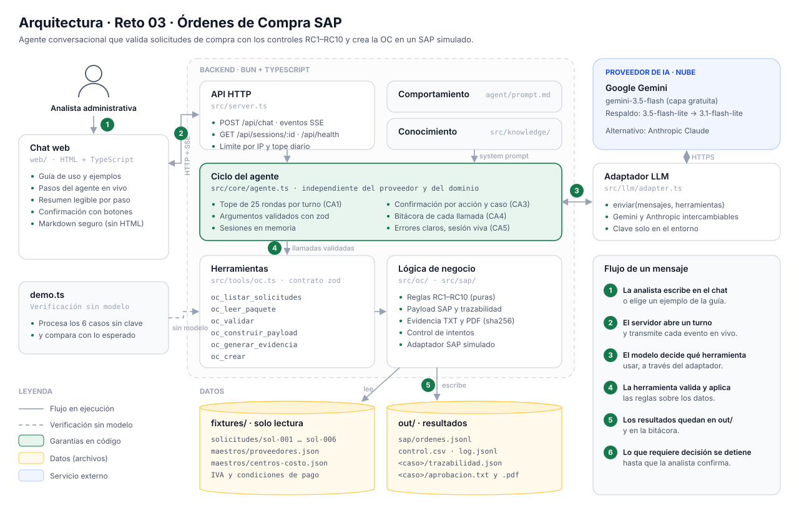

# SOLUCION — Reto 03: Órdenes de Compra SAP

## 1. Problema en una frase

La analista administrativa digita a mano en SAP cada orden de compra y valida de memoria que quien aprueba pueda aprobar ese monto en ese centro de costo. Eso cuesta tiempo, deja pasar errores que se corrigen en el cierre contable y le impide a la dirección saber cuántas compras se hacen antes de tener OC.

## 2. Arquitectura

*El diagrama muestra las capas (chat, API, ciclo del agente, herramientas, lógica y datos), el proveedor de IA, la verificación sin modelo (`demo.ts`) y el flujo numerado de un mensaje.*

| Capa | Dónde | Qué contiene |
|---|---|---|
| Comportamiento | `agent/prompt.md` | Cómo conversa el agente, cuándo pregunta y cómo presenta resultados |
| Conocimiento | `src/knowledge/ordenes-compra.md` | El proceso, los controles RC1–RC10, las OC retroactivas y los datos de SAP. Se anexa al prompt |
| Ejecución | `src/tools/oc.ts` → `src/oc/` | Herramientas tipadas con zod y, debajo, la lógica de negocio como funciones puras |

Un cambio de reglas de negocio toca `src/oc/reglas.ts` y el conocimiento. Nunca toca el servidor ni el ciclo del agente.

## 3. Ciclo del agente

El ciclo es propio (`src/core/agente.ts`, unas 250 líneas) y no depende del proveedor:

1. Se agrega el mensaje del usuario al historial de la sesión, que solo crece.
2. Se llama al modelo a través de `AdaptadorLLM.enviar(mensajes, herramientas)`. El texto se transmite al chat a medida que llega.
3. Si el modelo pide herramientas, cada argumento se valida con zod antes de ejecutar. Si no cumple, el error vuelve al modelo para que corrija. Cada llamada y su resultado se emiten al chat y se escriben en `out/log.jsonl`.
4. Se repite hasta que el modelo responde sin herramientas.

**Topes (CA1 y costo).** Hay un máximo de 25 rondas por turno: en la última, los resultados van con una nota que le pide al modelo cerrar con lo que tiene. Si aun así pide más herramientas, no se ejecutan y el turno termina con un resumen determinista de lo hecho y lo que falta. Para el costo hay tres topes configurables: tokens por conversación, **tokens por día para todo el servidor** (el link es público y cualquiera podría abrir conversaciones nuevas) y **mensajes por IP** en una ventana de minutos. A eso se suma un timeout al proveedor.

**Confirmación humana (CA3), en tres capas:**
1. **La herramienta decide.** `oc_validar` y `oc_crear` devuelven un campo `confirmacion` cuando hay excepciones (RC5, RC6, RC8, RC9). `oc_crear` no crea la OC sin `confirmado: true`.
2. **El backend garantiza, por acción y por caso.** Cada confirmación queda ligada a la herramienta que la pidió y al caso (`caso` o `mensaje_id`). Confirmar sol-004 no autoriza crear sol-005, y un "sí" a otra pregunta no autoriza nada más. Una validación puede declarar qué acción habilita (por ejemplo, validar habilita crear o registrar). `confirmado: true` solo pasa si el siguiente mensaje del usuario confirma sin negar; si el modelo lo usa por su cuenta, el backend lo bloquea. La detección reconoce "sí" con tilde y frases como "confirmo, no hay más cambios".
3. **El chat lo hace visible.** El evento `fin_turno` trae `necesitaConfirmacion`, y el front resalta el turno con botones de respuesta rápida.

**Bitácora (CA4).** Toda llamada queda en `out/log.jsonl`, también las que no llegan a ejecutarse (herramienta desconocida, argumentos inválidos, confirmación bloqueada o fuera del tope), marcadas con `ejecutada: false`.

**Adaptador LLM.** La interfaz es `enviar(mensajes, herramientas, opciones)`. El tercer parámetro lleva el system prompt y el callback de streaming: el contrato del PRD no lo nombra, pero cualquier proveedor lo necesita. Cambiar de proveedor no toca el ciclo.

**Interfaz de chat.** La pantalla inicial propone instrucciones de ejemplo. Cada respuesta muestra los pasos del agente: la herramienta, sus argumentos y un resumen en lenguaje natural que escribe la propia herramienta (el JSON completo queda plegado). Las respuestas se renderizan en Markdown escapando todo el HTML, y la confirmación se destaca con botones.

**Errores (CA5).** Los errores del proveedor se traducen a mensajes claros, por ejemplo "se alcanzó el límite de uso gratuito, espera un minuto". La sesión sigue viva y un caso malo no impide procesar el siguiente.

## 4. Elección del modelo

**Proveedor y modelo:** Google Gemini, `gemini-3.5-flash`, con respaldo automático a `gemini-3.5-flash-lite` y luego a `gemini-3.1-flash-lite`.

**Por qué:**
- **Costo cero para la demo.** La capa gratuita de Google AI Studio no exige tarjeta. Así se cumple el requisito de que nadie pueda gastar la clave sin límite: en la capa gratuita no hay facturación posible.
- **Llamada a herramientas fiable.** En las pruebas reales encadenó validar → construir → crear sin errores, y respetó el flujo de confirmación.
- **Disponibilidad.** En la capa gratuita, los modelos más nuevos a veces responden 503 (saturado) o 429 (cuota). El adaptador pasa al siguiente modelo de respaldo en la misma petición, siempre que aún no haya emitido texto al usuario. Cada modelo tiene su propia cuota, así que encadenar tres multiplica la capacidad. En la prueba del lote completo ocurrió dos veces con 429 y el usuario no lo notó.
- **Independencia del proveedor.** Hay una segunda implementación (`anthropic.ts`) y se cambia con `LLM_PROVIDER=anthropic`, sin tocar el ciclo del agente.

**Costo estimado por caso.** Medí el consumo real con Gemini:

| Escenario | Llamadas al modelo | Tokens de entrada | Tokens de salida |
|---|---|---|---|
| sol-004 completo (revisar, preguntar y crear tras "confirmo") | 4 | ~26.000 | ~2.300 |
| Lote de los 6 casos en un turno | 11 | ~55.500 (+27.800 desde caché) | ~4.700 |

En la capa gratuita, el costo es **$0**. Para producción con un modelo de pago, tomando ~26.000 tokens de entrada y ~2.300 de salida por caso (el peor caso: dos turnos con confirmación) y las tarifas públicas de Anthropic por millón de tokens:

| Modelo | Entrada / salida (USD por millón) | Costo por caso | 10 OC al día (≈ 220 al mes) |
|---|---|---|---|
| Claude Haiku 5.5 | 0,10 / 0,50 | ≈ USD 0,004 | ≈ USD 0,8 |
| Claude Sonnet 5.5 | 2 / 10 | ≈ USD 0,075 | ≈ USD 17 |
| Claude Opus 5.5 | 4 / 20 | ≈ USD 0,15 | ≈ USD 33 |

Para Gemini en capa de pago se aplica la misma fórmula con su tarifa vigente. La caché de prompts abarata la entrada en los turnos siguientes, porque el prompt, las herramientas y el historial se repiten. Como las reglas viven en el código y no en el modelo, el trabajo del modelo es leer resultados y redactar, así que un modelo pequeño basta. Recomendaría el más barato que pase el flujo de la sección 11 del PRD.

## 5. Matriz de controles

Todas las reglas están en `src/oc/reglas.ts`, son funciones puras (el mismo paquete da siempre el mismo resultado) y tienen tests sobre los fixtures y sobre variantes sintéticas.

| Regla | Implementación | Tipo | Caso que la activa |
|---|---|---|---|
| RC1 | Busca por NIT normalizado (sin puntos ni dígito de verificación). Sin NIT, compara el nombre sin tildes, mayúsculas, puntuación ni sufijos societarios. Revisa `activo` | Bloqueo | sol-002 (NIT inexistente); sol-006 lo encuentra por nombre |
| RC2 | Exige aprobación, que el cuerpo diga "Aprobado" sin negación delante y que el remitente esté en `aprobadores` del centro | Bloqueo | sol-003 (aprobador de otro centro) |
| RC3 | `valor_total ≤ tope` del aprobador. Si RC2 falla, queda "no evaluable" | Bloqueo | Variante en tests |
| RC4 | Subárea dentro de `subareas` del centro | Bloqueo | Variante en tests |
| RC5 | `|cotización − solicitud| / solicitud ≤ 2 %`. Sin cotización o con total ilegible, pide confirmación. Devuelve ambos valores, la diferencia y el porcentaje | Confirmación | sol-004 (6 %) |
| RC6 | Si falta el IVA, propone `indicador_iva_default` del proveedor y pide confirmación | Confirmación + derivado | sol-006 (C1) |
| RC7 | Si faltan las condiciones de pago, las deriva del proveedor y solo informa | Derivado | sol-006 (Z030) |
| RC8 | `factura.fecha < fecha_solicitud` → `retroactiva = true` y confirmación; queda en `control.csv` | Confirmación | sol-005 |
| RC9 | Fecha de aprobación (día calendario) ≥ fecha de solicitud | Confirmación | Variante en tests |
| RC10 | `|cantidad × valor_unitario − valor_total| ≤ 1` | Bloqueo | Variante en tests |

`oc_validar` devuelve además el estado de **cada** regla (ok, bloqueo, confirmación, derivado o no aplica), para que el agente pueda mostrar qué pasó y qué no.

**La más difícil: RC1.** El problema no es el código sino decidir qué es "el mismo proveedor". La solicitud trae el NIT sin dígito de verificación, la cotización lo trae con puntos y dígito (`900.555.111-2`) y sol-006 no lo trae. Por nombre, "TecnoSuministros S.A.S." debe coincidir con "tecnosuministros sas", pero normalizar demasiado arriesga falsos positivos. Lo resolví priorizando el NIT y usando el nombre solo como respaldo, comparándolo exacto tras normalizar, sin similitud difusa. En producción esto se consultaría en SAP por NIT; el nombre solo debería servir para proponer, nunca para decidir.

## 6. Diseño del adaptador SAP real

**Opción elegida: OData `API_PURCHASEORDER_PROCESS_SRV` (S/4HANA), expuesta a través de SAP Integration Suite o SAP BTP Destination.**

| Opción | Ventaja | Por qué no como primera opción |
|---|---|---|
| **OData `API_PURCHASEORDER_PROCESS_SRV`** | API estándar y documentada, REST/JSON, valida igual que ME21N y devuelve errores por campo | — Elegida |
| RFC/BAPI `BAPI_PO_CREATE1` | Funciona en ECC sin S/4 | Necesita SAP Cloud Connector o JCo y un `BAPI_TRANSACTION_COMMIT` explícito, y su manejo de errores es más opaco |
| Integration Suite (iFlow) | Desacopla, reintenta y monitorea | Es una capa más; tiene sentido si ya existe en Periferia |
| Carga por archivo | No requiere conexión | Es el plan B (ver abajo) |

Como la viabilidad no está confirmada, primero verificaría la versión de SAP. Si es S/4HANA, va OData; si es ECC, va el BAPI. El contrato `SapAdapter` no cambia: solo se agrega `src/sap/odata.ts` junto a `mock.ts`.

**Mapeo del payload (7.4) a OData.** Los nombres exactos se validan contra el `$metadata` del sistema destino.

| Payload | Entidad / campo OData |
|---|---|
| `sociedad`, `organizacion_compras` | `A_PurchaseOrder.CompanyCode`, `PurchasingOrganization` (+ `PurchasingGroup` y `PurchaseOrderType = NB` por configuración) |
| `proveedor.codigo_sap` | `Supplier` |
| `moneda`, `condiciones_pago` | `DocumentCurrency`, `PaymentTerms` |
| `referencia.solicitud_id` | Campo de referencia externa de la cabecera; es la llave de idempotencia |
| `posiciones[]` | `to_PurchaseOrderItem`: `PurchaseOrderItem` (10, 20…), `PurchaseOrderItemText`, `OrderQuantity`, `PurchaseOrderQuantityUnit`, `NetPriceAmount`, `TaxCode`, `AccountAssignmentCategory = K` |
| `centro_costo` | `to_AccountAssignment.CostCenter` (+ `GLAccount` según la categoría de compra) |
| `subarea` | No tiene campo estándar: se mapea a un campo de cliente o a la cuenta de mayor, a definir con Contabilidad |
| `aprobador.evidencia_sha256` y el PDF | Adjunto a la OC con el servicio de anexos (GOS) y el hash en el texto de cabecera |
| `excepciones` | Texto de cabecera con las excepciones confirmadas y por quién |

**Autenticación y credenciales.** Usaría un usuario técnico con permisos mínimos (crear OC y leer proveedores) y autenticación OAuth 2.0 *client credentials* vía BTP Destination, o un certificado X.509. Las credenciales viven en el gestor de secretos del entorno de despliegue (por ejemplo, AWS Secrets Manager o Azure Key Vault) y se inyectan solo en el adaptador. El modelo, el prompt, el front y los logs nunca las ven: el agente solo puede llamar a `oc_crear`, que llama al adaptador.

**Idempotencia y errores parciales.**
- Antes de crear se busca la OC por la referencia de la solicitud (`buscarOrdenPorReferencia`). Si existe, se devuelve su número, igual que en el simulador.
- Si el `POST` falla por timeout, no se reintenta a ciegas: primero se busca por referencia, porque SAP pudo haberla creado.
- Si la OC se crea pero falla el adjunto de la evidencia, la OC queda registrada en `control.csv` como `creada_sin_evidencia`, el adjunto se reintenta aparte y se alerta. Nunca se crea una segunda OC para corregirlo.
- Los errores de negocio de SAP (proveedor bloqueado, centro de costo cerrado) se devuelven como `{ ok: false, error }` con el mensaje de SAP traducido.

**Plan B si la conexión no es viable:** el agente hace todo menos el último clic.
1. Genera la OC lista para digitar: los mismos campos, en el orden de las pantallas de ME21N, más la evidencia en PDF para adjuntar.
2. Acumula las OC aptas y confirmadas del día en un archivo de carga masiva (por ejemplo, para SAP Migration Cockpit) que un usuario con permisos sube.
3. Mantiene `control.csv`, así que la medición de retroactivas y bloqueos funciona igual.

El ahorro principal, que es validar los controles, armar la OC y generar la evidencia, se conserva sin integración.

## 7. Lectura del proceso: OC retroactivas

Una OC retroactiva significa que la compra ya ocurrió (llegó la factura) antes de que existiera la solicitud. En sol-005, la factura es del 10 de agosto y la solicitud del 27: diecisiete días comprando sin OC y sin pasar por la cotización. El correo del aprobador lo deja claro: *"Ya llegó la factura, por favor crear la OC para poder radicarla"*. La OC se está usando como trámite para poder pagar, no como control previo.

**Qué le diría a la dirección:** cada OC retroactiva es una compra que nadie validó antes de comprometer el gasto. Nadie verificó si el proveedor estaba activo, si el aprobador tenía tope ni si el precio cuadraba con una cotización. Hoy no se sabe cuántas hay. Con este agente, `out/control.csv` las marca una por una (`retroactiva = true`), así que en un mes se tiene el porcentaje real por centro de costo y por proveedor.

**Cambio de proceso que propondría,** gradual para no frenar la operación:
1. **Mes 1, medir:** el agente crea las retroactivas con confirmación y las marca. Se publica el indicador mensual: % de OC retroactivas por centro de costo.
2. **Mes 2, hacer visible:** cada retroactiva notifica al aprobador del centro con el monto y los días de desfase.
3. **Mes 3, política "sin OC no hay pago":** las facturas que lleguen sin OC previa se devuelven al proveedor, salvo una lista corta de excepciones (servicios públicos, urgencias) con un tope.

La decisión de tolerar o rechazar sigue siendo de la dirección, como plantea el PRD. El agente aporta la medición que hoy no existe.

## 8. Decisiones y trade-offs

| # | Decisión | Alternativa descartada | Por qué |
|---|---|---|---|
| 1 | **Las herramientas recalculan todo desde los fixtures.** Los argumentos `paquete`, `derivados` y `payload` son opcionales y solo se comparan; `oc_crear` rechaza un payload que difiera del calculado | Pasar el paquete y el payload de herramienta en herramienta a través del modelo, como sugiere la tabla de 6.2 | Es la mitigación del riesgo "el modelo arregla un monto para que cuadre". El modelo no puede alterar lo que se crea en SAP, y además ahorra tokens |
| 2 | **Confirmación garantizada por el backend** (guardia de `confirmado`), además del prompt | Confiar solo en el prompt | Un prompt se puede saltar. En la primera prueba real, el modelo pidió confirmación por su cuenta sin consultar la herramienta; eso llevó a reforzar el prompt y a que la decisión la tome siempre la herramienta |
| 3 | **Ciclo del agente propio y adaptador LLM neutral** | Un framework (LangChain, Vercel AI SDK) o el tool runner de un SDK | El PRD evalúa el ciclo, y el propio cabe en unas 250 líneas explicables una a una. Permite la pausa de confirmación entre turnos y cambiar de proveedor sin tocarlo |
| 4 | **Gemini en capa gratuita con modelo de respaldo** | Un modelo de pago | Costo cero y sin riesgo de factura. El respaldo compensa la saturación de la capa gratuita |
| 5 | **Reglas como funciones puras separadas de la E/S** (`src/oc/reglas.ts`) | Validar dentro de cada herramienta | Se prueban sin archivos, `demo.ts` y el chat usan exactamente la misma lógica, y cambiar una regla no toca nada más |
| 6 | **Front en HTML + TypeScript sin framework, con SSE** | React con WebSockets | Para un chat basta, Bun lo empaqueta sin configuración y SSE es unidireccional, que es lo que se necesita |

### Dependencias

| Dependencia | Para qué | Alternativa descartada |
|---|---|---|
| `zod` | Esquemas de los argumentos de herramientas y de los datos (obligatorio por el PRD) | — |
| `@google/genai` | SDK oficial de Gemini, el proveedor por defecto | Llamar la API REST a mano: más código propio y sin tipos |
| `@anthropic-ai/sdk` | Segundo adaptador, para demostrar que el proveedor se cambia sin tocar el ciclo | — |
| `pdf-lib` | Evidencia de aprobación en PDF (HU-4, P1) con fecha fija para que sea determinista | Generar el PDF con una herramienta externa: rompe el "sin comandos de shell" |
| `typescript`, `@types/bun` (solo desarrollo) | Verificación de tipos estricta | — |

Bun aporta el servidor HTTP, el empaquetado del front, el test runner y la lectura de archivos, así que no hicieron falta Express, Vite ni Jest.

## 9. Supuestos

1. `valor_total` de la solicitud incluye IVA, porque así cuadra con el "TOTAL (IVA incluido)" de las cotizaciones. RC5 compara ese total con el de la cotización.
2. Las fechas se comparan como día calendario en la zona horaria en que vienen (la aprobación trae `-05:00`).
3. RC3 no se evalúa si RC2 falla: si el aprobador no pertenece al centro, no tiene tope en él.
4. Si el centro de costo no existe, se bloquea por RC2 y RC4.
5. La unidad de medida se infiere de la descripción: "horas" → `H`, mensualidades → `MES`, el resto → `UN`. La solicitud no trae unidad.
6. El texto breve se corta en el último espacio dentro de 40 caracteres y sin conectores finales ("de", "para"…).
7. La validez de la cotización se calcula y se muestra, pero no es una regla, porque el PRD no la define como control.
8. `control.csv` registra los intentos de **creación** (creada, existente, bloqueada o pendiente). Validar no es un intento.
9. Una sola posición por OC, porque cada solicitud trae un ítem. El esquema admite varias.
10. `confirmado_por` registra la sesión del chat. Con autenticación, sería el usuario.
11. La trazabilidad usa solo las fuentes que admite el PRD (`solicitud`, `cotizacion`, `maestro.<nombre>`, `derivado`). El detalle va en una nota: por ejemplo, el aprobador es `maestro.centros-costo` (verificado por RC2) y las constantes de SAP son `derivado`.
12. `control.csv` registra también los intentos que fallan por un error (aprobación ausente o payload alterado) con `resultado = error`.
13. `buscarOrdenPorReferencia` devuelve además la `fecha` de creación, una extensión opcional y compatible del contrato `SapAdapter`, para informarla en la respuesta idempotente.
14. Un total de cotización ilegible queda como `null` (no `NaN`) y RC5 lo trata como "sin cotización legible".

## 10. Cobertura

| Historia | Estado | Notas | Falta para producción |
|---|---|---|---|
| HU-1 Leer el paquete | ✅ Hecho | Adjuntos ausentes → `null` + `faltantes` | Leer `.xlsx`, `.pdf` y `.eml` reales (P1, no hecho) |
| HU-2 Validar | ✅ Hecho | RC1–RC10 con estado por regla | Maestros en vivo desde SAP |
| HU-3 Payload | ✅ Hecho | Validado con zod y trazabilidad por campo | Mapear subárea con Contabilidad |
| HU-4 Evidencia | ✅ Hecho | P0 `.txt` y P1 `.pdf` (pdf-lib) con sha256 | Firma digital si Auditoría la exige |
| HU-5 Crear en SAP | ✅ Hecho (simulado) | Numeración desde 4500000001, idempotente, `control.csv` | Adaptador OData real (sección 6) |
| HU-6 Errores | ✅ Hecho | JSON malformado, monto no numérico, caso inexistente y nombre de caso inseguro | Alertas y monitoreo |
| `oc_leer_excel` (P1) | ❌ No hecho | Opcional | — |
| Bonus `modulo/` | ✅ Hecho | Generado de las mismas fuentes y verificado por test | — |

**Otros puntos para producción:** autenticación de la analista, sesiones en Redis en vez de memoria, una base de datos en lugar de archivos y una cola para el lote diario.

## 11. Uso de IA

Usé **Claude Code** (modelo Claude Opus 5.5) como asistente de desarrollo durante todo el reto:

| Tarea | Qué hizo la IA | Qué decidí o revisé yo |
|---|---|---|
| Análisis | Leyó los tres PRD y los fixtures, comparó la dificultad y armó la tabla de resultados esperados por caso | Elegir el reto y la estrategia de un núcleo común |
| Arquitectura | Propuso el ciclo del agente, el adaptador neutral y el contrato de herramientas | Ajustarlos a la sección 6 del PRD |
| Código y tests | Escribió el núcleo, el dominio, el front y los tests | Revisar cada regla contra la sección 7.3 y las pruebas en vivo |
| SDKs | Leyó los tipos de los SDK instalados (`@google/genai`, `@anthropic-ai/sdk`) antes de usarlos, en vez de escribirlos de memoria | — |
| Documentación | Redactó README, CLAUDE.md y este documento | Validar supuestos y redacción |

**Lo que descarté de lo propuesto:**
- **BMAD** como metodología: el PRD ya define requisitos y arquitectura, y la ceremonia no aportaba.
- **La primera versión de la confirmación,** con botones que pausaban la ejecución. No cumplía CA3 ("solo procede si el siguiente mensaje confirma"), así que pasé a una confirmación conversacional garantizada por el backend.
- **Anthropic como proveedor por defecto:** lo cambié por la capa gratuita de Gemini por costo. El adaptador de Anthropic quedó como alternativa.
- **`gemini-flash-latest` como modelo:** en las pruebas reales devolvía 503 por saturación. Medí qué modelos respondían y elegí `gemini-3.5-flash` con respaldo.
- **Que el modelo calcule diferencias:** en una prueba el modelo calculó por su cuenta la diferencia de $1.500.000 de sol-004. Ahora la herramienta la entrega y el modelo solo la cita (CA2).

`CLAUDE.md` deja las convenciones para que cualquier asistente, o persona, que trabaje en el repo las respete.

## 12. Riesgos de llevar esto a producción

| Riesgo | Mitigación |
|---|---|
| El modelo inventa o altera un valor | Las herramientas son la única fuente. `oc_crear` recalcula y rechaza un payload distinto, y el prompt prohíbe afirmar valores sin herramienta |
| Se crea una OC sin confirmación | Guardia en el backend independiente del prompt, más el test que lo verifica |
| OC duplicadas por reintentos | Idempotencia por `solicitud_id`. Ante un timeout, buscar antes de reintentar |
| Maestros desactualizados | Consultar proveedores y aprobadores en SAP en tiempo real, no en archivos |
| Saturación o cuota del proveedor de IA | Modelo de respaldo y mensajes claros. En producción, una capa de pago con límite de gasto |
| Fuga de credenciales | Claves solo en el gestor de secretos y el adaptador. Nunca en el prompt, el front ni los logs |
| Datos personales en los logs | `out/log.jsonl` guarda argumentos y resúmenes. En producción: retención limitada y enmascaramiento de correos |
| Inyección de instrucciones en los correos (texto del proveedor) | Los textos se tratan como datos: las decisiones salen de reglas en código, no de lo que diga el correo |
| Plantillas reales más desordenadas que los fixtures | Lectura de Excel y PDF con validación zod. Lo que no cuadra se devuelve como error legible, no se adivina |
